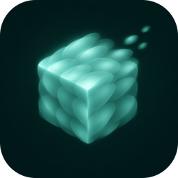
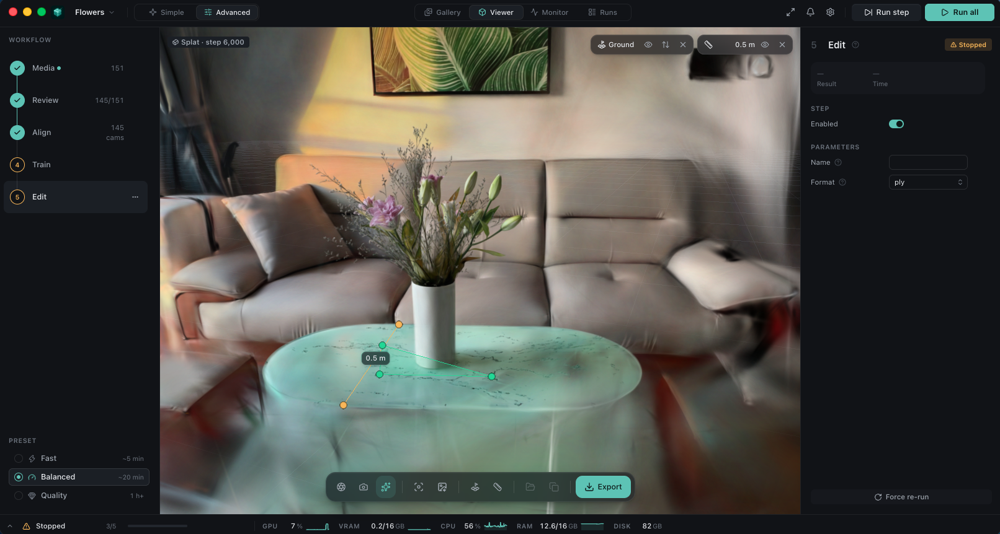

<p align="center"></p>

# SplatCraft

**A free, open-source Gaussian Splatting studio.** Drop in photos or videos and get a 3D splat. SplatCraft extracts and filters frames, aligns the cameras, trains the splat with a live preview, and exports it, all on your own machine.



> **Status:** early prototype (v0.1.x). Tested on macOS (Apple Silicon). Windows and Linux are wired up but untested.

## Download
Get the latest build from [Releases](https://github.com/fabianfreund/SplatCraft/releases/latest): a signed and notarized `.dmg` for macOS (Apple Silicon or Intel), an `.exe` installer for Windows, and an `.AppImage` / `.deb` for Linux.

## Highlights
- **One flow from drop to splat:** Media → Review → Align → Train → Export, shown as a clear stepper.
- **Simple and Advanced modes:** presets for everyone, plus per-step parameters, monitoring and run history for those who want them.
- **Live 3D preview:** points, cameras and the splat update while training runs.
- **Hardware monitor:** GPU, VRAM, CPU, RAM and disk, plus training charts.
- **Your look:** dark, light or system theme, accent color, density, text size and custom themes.
- **Extensible:** every step is a plugin, so the trainer and other engines can be swapped.

## Quick start
```bash
pnpm install
pnpm dev                                    # desktop app (Electron)
pnpm --filter @splatcraft/desktop dev:web   # UI only, in the browser with mock data (+ ?kit for the UI kit)
```
On macOS, SplatCraft finds `ffmpeg` and `colmap` from Homebrew and downloads Brush itself (Settings → Tools & Add-ons).

Headless CLI:
```bash
./scripts/fetch-sample.sh                         # test scene (NVlabs instant-ngp fox)
pnpm cli new ~/Scans "Fox"
pnpm cli add ~/Scans/Fox.splatcraft samples/fox/images
pnpm cli run ~/Scans/Fox.splatcraft --preset fast
```

## Project layout
```
apps/desktop         Electron app (main, preload, React renderer)
packages/core        project model, plugin registry, pipeline engine (cache, resume, cancel)
packages/plugins     built-in steps: media, quality, colmap, brush, export, monitor
packages/toolchain   finds / installs external tools
packages/cli         headless runner
docs/                research, architecture, design review
```
### Writing a plugin
```ts
import { definePlugin, defineStage } from '@splatcraft/core';
import { z } from 'zod';

export default definePlugin({
  id: 'acme.denoise', name: 'Denoise', version: '0.1.0',
  register(api) {
    api.registerStage(defineStage({
      id: 'acme.refine.denoise', version: '1', title: 'Denoise', description: '…',
      category: 'refine', inputs: ['frames'], outputs: ['frames'],
      paramsSchema: z.object({ strength: z.number().min(0).max(1).default(0.5) }),
      async run(ctx) { /* write to ctx.workDir, report ctx.progress / ctx.preview */ return { outputs: { frames: { path: ctx.workDir } } }; },
    }));
  },
});
```
Steps connect by artifact kind (`sources → frames → dataset → splat → export`), so any stage can be swapped for another with the same inputs and outputs. The params schema drives both validation and the Advanced UI.

More detail is in [CLAUDE.md](CLAUDE.md) (contributor and agent guide), [docs/RELEASING.md](docs/RELEASING.md), [docs/ARCHITECTURE.md](docs/ARCHITECTURE.md), [docs/design/UI-REVIEW.md](docs/design/UI-REVIEW.md) and the [UI library guide](apps/desktop/src/renderer/src/ui/README.md).

## Built with
**External tools** (each keeps its own license):

| Tool | Used for | License |
|---|---|---|
| [Brush](https://github.com/ArthurBrussee/brush) | Gaussian splat training | Apache-2.0 |
| [COLMAP](https://colmap.github.io) | Camera alignment (structure from motion) | BSD |
| [FFmpeg](https://ffmpeg.org) | Frame extraction from video | LGPL / GPL, depending on the build |

**Libraries:**

| Area | Libraries |
|---|---|
| App shell | [Electron](https://www.electronjs.org), [electron-vite](https://electron-vite.org), [electron-builder](https://www.electron.build) |
| UI | [React](https://react.dev), [Tailwind CSS](https://tailwindcss.com), [Zustand](https://zustand.docs.pmnd.rs), [Lucide](https://lucide.dev) icons, [clsx](https://github.com/lukeed/clsx) |
| 3D | [three.js](https://threejs.org), [Spark](https://sparkjs.dev) (Gaussian splat rendering) |
| Core | [Zod](https://zod.dev) (schemas and validation), [sharp](https://sharp.pixelplumbing.com) (image processing) |
| Tooling | [TypeScript](https://www.typescriptlang.org), [Vite](https://vite.dev), [Vitest](https://vitest.dev), [tsx](https://tsx.is), [pnpm](https://pnpm.io) |

Sample data: the fox scene from [NVlabs instant-ngp](https://github.com/NVlabs/instant-ngp). It is downloaded by the fetch script, not bundled.

## About
SplatCraft is made by **Fabian Builds** ([@fabianfreund](https://github.com/fabianfreund)).

**Built with AI.** Most of SplatCraft's code, design and docs were written with [Claude Code](https://claude.com/claude-code), steered and reviewed by a human. If you don't want to use or support software made with AI tools, that's a fair choice, and SplatCraft isn't for you. There are great hand-made alternatives.

SplatCraft is **not affiliated with ArtCraft** (yet), or with any of the tools and projects listed above.

## License
[MIT](LICENSE). Third-party tools and libraries keep their own licenses.
